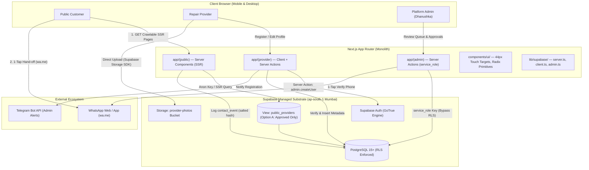
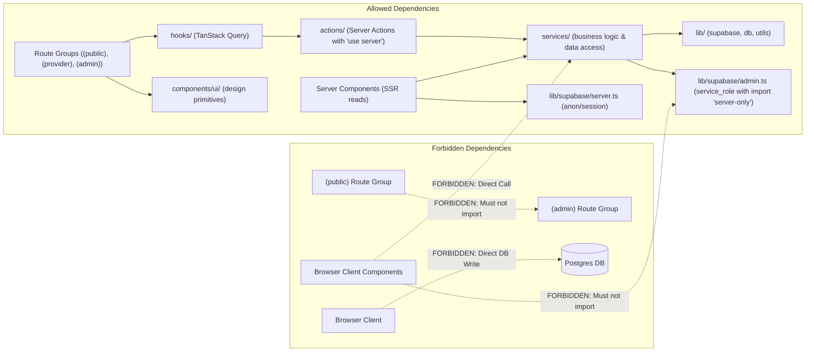
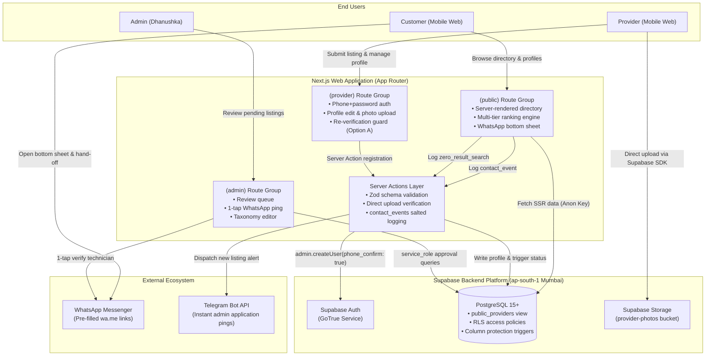
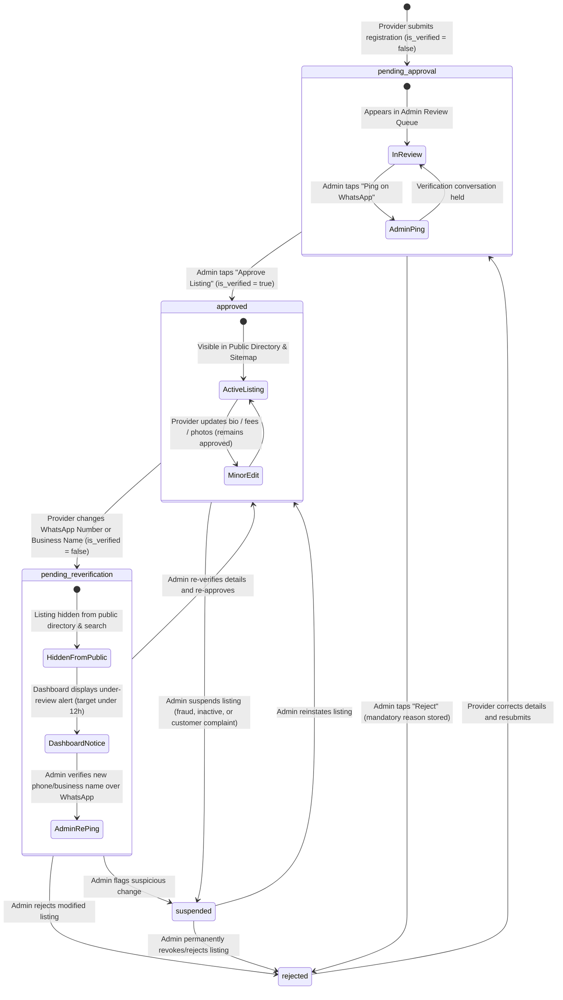

# Architecture Spine — FixNear (Phase 1 — Negombo Pilot)

## Design Paradigm

FixNear is architected as a **Modular Monolith with Server-Driven Vertical Slices** built on Next.js 15 (App Router) and Supabase. The entire system deploys as a single unified application with strict boundary isolation implemented via Next.js Route Groups:
- `(public)`: Public directory browsing, multi-facet search, SEO landing pages, provider profile views, and WhatsApp hand-off sheets. Driven by React Server Components for zero-client-JS overhead and instant mobile First Contentful Paint.
- `(provider)`: Technician and repair workshop onboarding, mobile+password authentication, listing self-management dashboard, and direct-to-storage photo uploads.
- `(admin)`: Product owner review queue, 1-tap WhatsApp verification trigger, taxonomy editor, and listing moderation actions.

State mutations and business logic are strictly encapsulated within **Next.js Server Actions** with Zod schema validation. Client-side state and optimistic updates in authenticated portals utilize **TanStack Query**. Supabase acts as the managed infrastructure substrate (PostgreSQL 15+, Supabase Auth, and Supabase Storage in region `ap-south-1` Mumbai), governed by PostgreSQL Row-Level Security (RLS) policies and detailed in the companion [DATA-MODEL.md](file:///Users/dhanushka/Downloads/MYPROJECTS/BMAD/_bmad-output/planning-artifacts/architecture/architecture-fixnear-2026-10-14/DATA-MODEL.md).



---

## Invariants & Rules



### AD-1 — Next.js App Router + TypeScript Full-Stack Monolith [ADOPTED]

- **Binds:** `all`, `FR-101` through `FR-603`, `NFR-101` through `NFR-401`
- **Prevents:** Multi-repository divergence, multi-service deployment latency, schema mismatch across API boundaries, and duplicate type maintenance.
- **Rule:** The entire application resides in a single TypeScript Next.js repository using the App Router. Direct client-side `fetch` calls to internal API routes for initial page rendering are forbidden; all public directory reads must execute server-side within React Server Components to guarantee crawlability and sub-2.5s mobile LCP. Provider profile URL slugs must be generated server-side during registration as `slugify(business_name || personal_name) + '-' + nanoid(6)` (e.g. `kamal-electricals-a7b3c9`) to ensure global collision-free uniqueness. A provider's slug is strictly **IMMUTABLE**: renaming `business_name` or `personal_name` preserves the existing slug to prevent breaking indexed SEO URLs, external bookmarks, or shared WhatsApp links.

### AD-2 — Supabase as Managed Backend Substrate (PostgreSQL, Auth, Storage) [ADOPTED]

- **Binds:** `FR-301` through `FR-506`, `NFR-301`, `NFR-302`
- **Prevents:** Infrastructure operational overhead, custom authentication vulnerabilities, and multi-cloud storage fragmentation.
- **Rule:** PostgreSQL 15+, Supabase Auth, and Supabase Storage provide data persistence, identity management, and media hosting. Direct client-side writes to PostgreSQL are prohibited; all database writes must flow through server-side Next.js Server Actions with Zod validation. The complete table schema, constraints, and relationships are formally specified in the companion document [DATA-MODEL.md](file:///Users/dhanushka/Downloads/MYPROJECTS/BMAD/_bmad-output/planning-artifacts/architecture/architecture-fixnear-2026-10-14/DATA-MODEL.md).

### AD-3 — Provider Phone Auth Spike, Password Reset & Anti-Spam Protections [ADOPTED]

- **Binds:** `FR-301`, `FR-302`, `FR-305`, `FR-306`, `NFR-303`, `UJ-2`
- **Prevents:** Expensive third-party SMS gateway (Twilio) lock-in, SMS delivery failures across Sri Lankan telecom networks, provider account lockout, and registration spam.
- **Rule:**
  1. **Pre-Implementation Spike:** Prior to building provider onboarding stories, engineering must execute an isolated integration test on a live Supabase project to verify:
     - `supabaseAdmin.auth.admin.createUser({ phone: e164_number, password: plain_password, phone_confirm: true })`
     - Subsequent client/server authentication via `supabase.auth.signInWithPassword({ phone: e164_number, password: plain_password })`
     - Whether enabling the Phone provider toggle in the Supabase Dashboard requires configuring an SMS gateway.
  2. **Spike Fallback Rule:** If Supabase Cloud strictly blocks phone creation without an active SMS gateway, engineering must immediately adopt a synthetic internal email identifier:
     `auth_email = phone_digits + "@fixnear.invalid"` (using the RFC 2606 reserved `.invalid` top-level domain; email sending and confirmation disabled in Supabase Auth project configuration). Providers will still input their Mobile Number and Password in the UI, and the Server Action will map the phone to the internal email identifier transparently.
  3. **Registration Execution:** Provider account creation must never be invoked from the browser via client-side `signUp()`. Registration must run inside a Server Action utilizing the Supabase Admin API with `phone_confirm: true`.
  4. **Admin-Assisted Password Reset Protocol & Login Expiration Guard:**
     - The provider enters their registered mobile number on the "Forgot Password" screen and taps "Request Reset via WhatsApp".
     - Admin verifies the provider identity over WhatsApp referencing prior onboarding conversation history.
     - In the Admin Dashboard, Admin clicks "Generate Temporary Password".
     - Server Action generates a secure temporary password, updates the provider in Supabase Auth via `admin.updateUserById(providerId, { password: tempPassword })`, and sets `must_change_password = true` and `temp_password_expires_at = NOW() + INTERVAL '24 hours'` on the `providers` record.
     - **Login-Time Expiration Enforcement:** In the `loginProviderAction`, immediately upon credential validation via `signInWithPassword`, the action inspects `providers.temp_password_expires_at`. If `must_change_password = true` and `NOW() > temp_password_expires_at`, the Server Action immediately calls `supabase.auth.signOut()` and rejects the login with an explicit error: *"Your temporary password has expired (24-hour limit). Please contact FixNear Admin on WhatsApp to request a new temporary password."*
     - If the temporary password is valid (`NOW() <= temp_password_expires_at`), the user is restricted and redirected to `/provider/reset-password` until a new permanent password is saved.
  5. **Rate Limiting via PostgreSQL Table (`rate_limit_buckets`):**
     - Because Vercel serverless execution instances do not share in-memory state, rate-limit counters reside in a centralized PostgreSQL table `rate_limit_buckets` in Supabase using atomic upsert and sliding-window timestamp checks. (No Upstash Redis dependency in Phase 1):
       - Provider registration: max 3 per hour per IP. Protected by Cloudflare Turnstile (invisible/non-interactive CAPTCHA).
       - WhatsApp click logging (`contact_events`): max 10 per minute per IP. Duplicate clicks within 24 hours deduplicated using a salted hash: `SHA256(ip + user_agent + date + provider_id + CONTACT_HASH_SALT)` where `CONTACT_HASH_SALT` is a cryptographically secure server-only environment variable.

### AD-4 — Strict Server-Only Boundary for Service Role Key & Secrets Hygiene [ADOPTED]

- **Binds:** `all`, `FR-501` through `FR-505`, `NFR-302`
- **Prevents:** Complete database security bypass, malicious data exposure, token leakage in git, and accidental agent ingestion of live credentials.
- **Rule:**
  1. **Server Isolation:** The Supabase Service Role Key (`SUPABASE_SERVICE_ROLE_KEY`) must strictly and exclusively reside in server execution context (`lib/supabase/admin.ts`). It must NEVER be prefixed with `NEXT_PUBLIC_`, NEVER imported into client components or client bundles, and NEVER committed to git.
  2. **Agent & Subagent Secrets Boundary:** AI coding agents, subagents, and automated tools must NEVER read, inspect, or log real `.env` or `.env.local` files containing live credentials. Only the `.env.local.example` template (containing dummy placeholders) is accessible to agents or committed to git.
  3. **Automated Secret Scanning:** Automated secret scanning (via GitGuardian, Gitleaks, or pre-commit hooks) must run in CI to block any commit containing high-entropy keys or Supabase service role tokens.

### AD-5 — Row-Level Security, Column Protection Triggers & Option A Re-verification [ADOPTED]

- **Binds:** `FR-101`, `FR-105`, `FR-204`, `FR-303`, `FR-401`, `FR-402`, `FR-504`, `NFR-302`
- **Prevents:** Leakage of provider PII (hashed passwords, admin review notes, unapproved contact details) to anonymous visitors, unauthorized self-approval, unverified phone updates appearing in public search, and schema confusion between solo technicians and workshops.
- **Rule:**
  1. **Public Read Projection:** Anonymous visitors must NEVER query the raw `providers` table directly. Public directory reads must query the `public_providers` PostgreSQL View, which explicitly projects only approved, verified public fields where `requires_manual_repair = false` (`status = 'approved' AND is_verified = true AND requires_manual_repair = false`) and aggregates relations.
  2. **Option A Public Lockdown for Re-verification:** When a provider updates their `phone_number` or `business_name`, the listing enters `pending_reverification` and `is_verified = false`. Under Option A, **the listing is immediately hidden from the public directory and search results** until Admin re-verifies and approves the change.
  3. **Provider Dashboard Under-Review Notice:** While in `pending_reverification`, the provider's dashboard must render a clear alert:
     *"Your listing details were recently updated and are currently under review by FixNear Admin. During review, your listing is temporarily hidden from public search. We will reach out on WhatsApp shortly."*
  4. **Database Column Protection Trigger:** Enforced via `fn_enforce_provider_column_protection()`:
     - Admin / service-role executions (`current_setting('role', true) = 'service_role'` or caller in `admin_users`) have unrestricted mutation rights.
     - Authenticated non-admin providers are strictly blocked from directly altering `status`, `is_verified`, `provider_type`, `slug`, `must_change_password`, `temp_password_expires_at`, `rejection_reason`, `submitted_at`, and `requires_manual_repair` (PostgreSQL error `P0001`).
     - All provider-side status transitions are routed exclusively through PostgreSQL `SECURITY DEFINER` state machine functions (`fn_request_identity_reverification`, `fn_submit_provider_application`, `fn_resubmit_provider_application`, `fn_toggle_provider_listing_pause`) with an explicit allowlist of permitted state transitions:
       - `draft` → `pending_approval` (initial submission)
       - `pending_approval` → `approved` / `rejected` (admin only)
       - `approved` → `pending_reverification` (identity change)
       - `approved` → `suspended` (admin only)
       - `approved` → `paused` (provider-initiated pause; strictly allowed ONLY from `approved`)
       - `paused` → `approved` (provider-initiated resume; strictly allowed ONLY from `paused`, refused if `suspended`)
       - `paused` → `suspended` (admin only)
       - `paused` CANNOT transition to `pending_reverification`: phone and business name edits while paused are strictly blocked (*"Resume your listing first to edit critical contact details"*); direct invocation of `fn_request_identity_reverification` while paused raises PostgreSQL error `P0004` (must transition `paused → approved` first).
       - `pending_reverification` → `approved` / `rejected` / `suspended` (admin only)
       - `rejected` → `pending_approval` (resubmission, blocked if `is_permanently_rejected`)
       - `suspended` → `approved` (admin reinstatement only; providers can never unpause a suspended listing)
     - **SECURITY DEFINER RPC Permission Enforcement & Client Sourcing:** For every `SECURITY DEFINER` RPC accepting a provider ID:
       - Provider-authenticated RPCs (`fn_toggle_provider_listing_pause`, `fn_request_identity_reverification`, `fn_resubmit_provider_application`, `fn_submit_provider_application`, photo RPCs) are invoked strictly using the **user-scoped client** (`src/lib/supabase/server.ts`), validating `auth.uid() IS NOT NULL AND auth.uid() = p_provider_id` inside the function body, with `p_provider_id` originating strictly from the verified session (`session.user.id`).
       - Administrative/deletion RPCs (`fn_anonymise_and_delete_provider_data`, `fn_approve_identity_reverification`) are invoked strictly using the **service-role client** (`src/lib/supabase/admin.ts`), enforcing `REVOKE EXECUTE FROM PUBLIC, anon, authenticated; GRANT EXECUTE TO service_role;` with the target provider ID originating from the verified session or admin action.
     - **Standing `search_path` Security Invariant for `SECURITY DEFINER` Functions:** Every `SECURITY DEFINER` PostgreSQL function and trigger must explicitly pin its search path (`SET search_path = public`) in its definition header (`CREATE OR REPLACE FUNCTION ... SECURITY DEFINER SET search_path = public AS $$ ... $$`). This completely eliminates schema search-path hijacking attacks, ensuring all unqualified table and function references resolve strictly within the trusted `public` schema.
  5. **Critical Identity Change Staging & Auth Lifecycle:** When a provider updates their WhatsApp phone number or business name, edits are strictly blocked if `status = 'paused'` (*"Resume your listing first"*). When allowed, changes are written to dedicated staging columns `pending_phone_number` and `pending_business_name` via RPC `fn_request_identity_reverification()` (pre-checking the new number against HMAC-SHA256 `phone_blocklist` and uniqueness across live and pending numbers). The listing transitions to `status = 'pending_reverification'` and `is_verified = false`. Live `phone_number` and `business_name` remain intact and reserved in the database. The provider's Supabase Auth login identifier remains their verified phone number until Admin approves the change. When Admin approves, the Server Action executes in strict sequential order:
     - **Supabase Auth First:** Updates `auth.users.phone` via `supabaseAdmin.auth.admin.updateUserById` first (and updates synthetic email `<phone>@fixnear.invalid` [reserved RFC 2606 `.invalid` domain; email sending disabled in Supabase Auth] if chosen by the Story 1.2 auth spike). If Auth update fails, the operation immediately halts without touching the database.
     - **Database Promotion:** Only upon confirmed Auth success, invokes PostgreSQL `SECURITY DEFINER` RPC `fn_approve_identity_reverification` (`GRANT TO service_role`) to promote `pending_*` to live columns. Any promotion collision caught by PostgreSQL unique constraint `uq_providers_phone_number` (error code `23505`) rolls back the Supabase Auth update, automatically moves the listing to `status = 'suspended'`, and dispatches an urgent admin alert. If the Auth rollback itself fails after a database failure, the action logs the error with full diagnostic context, dispatches an urgent alert to **both administrators**, and sets `requires_manual_repair = true` on the provider record, halting automated workflows on the record. If Admin rejects the change, Admin simply clears `pending_*` columns, safely preserving or reinstating verified live columns. Further critical edits are blocked while in `pending_reverification`.
  6. **Mandatory CI Integration Tests for Both Directions:** Automated integration tests in CI must assert:
     - Provider blocked: Authenticated provider cannot update `status`, `is_verified`, or temporary credentials directly (fails with `P0001`).
     - Admin allowed: Admin user or service-role client successfully updates `status = 'approved'` and `is_verified = true`.
     - Phone update guard: Provider updating `phone_number` via RPC transitions row to `pending_reverification` and `is_verified = false`.
  7. **Provider Type Invariant (FR-303):** The schema enforces `provider_type` (`'individual' | 'business'`). For `business`, `business_name` is strictly required via database CHECK constraint (`chk_business_name`). Non-admin providers cannot alter `provider_type` or inject unverified business names without triggering re-verification.

### AD-6 — Operational Lifecycle: Backups, Inactivity Ping & Sri Lanka Region [ADOPTED]

- **Binds:** `NFR-201`, operational and deployment envelope
- **Prevents:** Service downtime caused by Supabase 7-day inactivity project pausing, cold-start latency spikes, unrecoverable data loss in development, and sub-optimal network routing.
- **Rule:**
  1. **Hosting Region:** Supabase project must be provisioned in region **`ap-south-1` (Mumbai, India)**. This region provides the lowest round-trip latency (sub-35ms) to Sri Lanka over direct Indian Ocean submarine fiber cables, outperforming Singapore (~50-60ms) and European regions.
  2. **Inactivity Keep-Alive Ping:** During Free Tier operation, an automated external cron (GitHub Action or uptime service) must ping `GET /api/health` every 3 days. This endpoint must execute an active database query (`SELECT 1` or query `categories`) to reliably reset the Supabase 7-day inactivity timer.
  3. **Database Backup Boundary & Storage Independence:** Official Supabase documentation (*Source: Supabase Docs — Backups & Storage, `https://supabase.com/docs/guides/platform/backups`*) explicitly confirms that Supabase database backups (Pro plan automated daily backups, PITR) and `pg_dump` **ONLY back up the PostgreSQL database**. They capture relational metadata in `storage.objects`, but **DO NOT include the underlying binary files stored in AWS S3**. Restoring a database backup alone leaves file references intact but binary content missing (HTTP 404 errors).
  4. **Photo Backup Plan & Phase 1 Accepted Risk:**
     - **Storage Mirroring Job:** Engineering establishes a scheduled weekly GitHub Action (`.github/workflows/storage-backup.yml`) utilizing Supabase S3-compatible Access Keys (or Supabase CLI) to mirror the `provider-photos` bucket to an independent secondary object store (Cloudflare R2 or secondary S3 bucket).
     - **Explicit Accepted-Risk Note:** The underlying AWS S3 infrastructure in `ap-south-1` natively guarantees 99.999999999% (11 9's) data durability against media loss. Because Phase 1 encompasses only 15–25 pilot providers with ~100–200 portfolio photos total (<50MB) and these photos are non-transactional marketing images re-uploadable by providers if ever lost, high-frequency continuous multi-cloud replication is an accepted risk deferred to Phase 2. The weekly automated CI bucket mirror provides sufficient disaster recovery.
  5. **Production Upgrade Gate:** Before onboarding public users or marketing in the Negombo pilot, the Supabase project must be upgraded to the **Pro Plan ($25/month)**. The base Pro plan includes **Daily Database Backups retained for 7 days** at no additional cost. Point-in-Time Recovery (PITR) is a paid add-on ($100/mo) and is NOT required for Phase 1. Upgrading to Pro permanently removes inactivity pausing and increases database storage to 8 GB. Baseline pricing verified on 2026-10-14 via official Supabase pricing documentation.

### AD-7 — Direct-to-Storage Photo Uploads & Server Verification Pipeline [ADOPTED]

- **Binds:** `FR-304`, `NFR-201`, `NFR-202`
- **Prevents:** Server Action body size limit failures (HTTP 413 Payload Too Large), mobile data exhaustion in Sri Lanka, Vercel free-tier commercial terms violations, and transformation quota lockouts.
- **Rule:**
  1. **Direct Client Upload Architecture:** Next.js Server Actions enforce body size limits (default 1MB, maximum 4MB on Vercel serverless). Passing high-resolution work photos (up to 10MB each) through Server Action payloads will crash the action. Therefore, photos must be uploaded directly from the browser to Supabase Storage:
     - Client-side image compression (via `browser-image-compression`) resizes images to max 1200px width/height in modern WebP format (~200KB).
     - Browser uploads directly to Supabase Storage bucket `provider-photos` using the Supabase client SDK: `supabase.storage.from('provider-photos').upload(path, file)`.
     - Bucket configuration enforces: max file size 10MB (`10485760` bytes) and allowed MIME types `['image/jpeg', 'image/png', 'image/webp']`.
     - Storage RLS Policy restricts uploads: authenticated users can only write to their own folder: `(storage.foldername(name))[1] = auth.uid()::text`.
  2. **Server Action Metadata Verification:** Once uploaded, the client calls `recordWorkPhotoAction({ providerId, storagePath, sortOrder, caption })`. The Server Action must strictly verify:
     - The caller is authenticated and `auth.uid() = providerId`.
     - The `storagePath` begins with `providerId + '/'`.
     - The object actually exists in Supabase Storage (`supabaseAdmin.storage.from('provider-photos').info(storagePath)`).
     - The object's real `contentType` is in `['image/jpeg', 'image/png', 'image/webp']` and `size <= 10485760`.
     - Only after all checks pass is the row inserted into `work_photos`.
  3. **Image Delivery Pipeline:** Work photos are displayed using the Next.js `<Image />` component with remote patterns configured for Supabase Storage, serving responsive modern WebP formats tailored to mobile viewports.
  4. **Hosting & Commercial Terms:**
     - **Initial Development / Free Pilot:** Hosted on Vercel Hobby plan (includes 5,000 Next.js Image transformations/month).
     - **Commercial Terms Compliance:** Vercel Hobby terms strictly restrict deployments to non-commercial use. Once FixNear engages in commercial activity (charging listing fees, ads, or monetization) or exceeds 5,000 monthly image transformations, hosting must transition to **Vercel Pro ($20/seat/month)** or a containerized Node.js deployment with native `sharp` (Railway or Docker on a VPS via Coolify).
  5. **Standardized Storage URL Resolution:** All components across route groups must resolve storage paths to public URLs using `getStoragePublicUrl(storagePath: string): string` in `src/lib/supabase/storage.ts`. Ad-hoc string manipulation or hardcoding Supabase storage origin URLs is prohibited.

### AD-8 — Parallel Developer Isolation & Shared Code Ownership [ADOPTED]

- **Binds:** Developer workflow and code organization
- **Prevents:** Merge conflicts, broken shared libraries, and database migration collisions between two parallel developers or AI agents.
- **Rule:**
  1. **Route Group Partitioning:** Feature implementation is partitioned across Next.js route groups:
     - Developer A / Agent 1 owns `src/app/(public)/` (Public directory, search, SEO, WhatsApp sheet).
     - Developer B / Agent 2 owns `src/app/(provider)/` and `src/app/(admin)/` (Onboarding, dashboard, review queue, taxonomy).
  2. **Shared Code Gate:** Shared directories (`src/lib/`, `src/components/ui/`, `src/hooks/`, `src/services/`), database migrations (`supabase/migrations/`), and RLS policies must have single-owner serialized changes. A developer modifying shared contracts must notify and merge sequentially to prevent divergence.

### AD-9 — Area Matching, Multi-Tier Search Ranking & Precise Success Metrics [ADOPTED]

- **Binds:** `FR-104`, `FR-105`, `FR-106`, `FR-107`, `FR-204`, `UJ-1`
- **Prevents:** Misleading customer recommendations, technician travel friction, unserved demand invisibility, and ambiguous pilot metrics.
- **Rule:**
  1. **Two-Tier Area Matching Hierarchy:** When a customer searches for repairs in a selected Area and Sub-Service:
     - **Tier 1 (In-Area Base Workshop):** Providers whose physical base workshop is located in the customer's selected area (`is_base_area = true`).
     - **Tier 2 (Visiting Coverage):** Providers whose base workshop is outside the customer's area, but whose `service_mode` includes `comes_to_customer` and who explicitly include the customer's area in their `areas_served`. Visiting cards must display the clear visual tag: *"Based in [Base Area], visits [Selected Area]"*.
     - Providers configured strictly as `customer_comes_to_shop` must NEVER appear in cross-area visiting results.
  2. **Photo-Driven Ranking Within Tiers:** Within both Tier 1 and Tier 2, providers with uploaded work photos (`photo_count > 0`) must rank strictly higher than providers without photos (`photo_count = 0`). Tie-breaker within photo groups is newest approved listing first (`created_at DESC`).
  3. **Zero-Result Search Logging:** When a customer performs a search that yields zero matching in-area or visiting providers, the application must asynchronously record the query parameters (`selected_area_id`, `selected_category_id`, `selected_sub_service_id`, `query_text`) into the `zero_result_searches` table. Customer personal data is never recorded.
  4. **Precise Pilot Success Metrics:**
     - **Supply Liquidity:** 15–25 verified, active providers across the Negombo pilot cluster across at least 3 managed categories within 4 weeks of launch.
     - **Active Contact Rate:** Greater than or equal to 60% of approved active listings receiving at least 2 verified, deduplicated `contact_events` per 30-day window.
  5. **JSONB Pre-Aggregation & Zero-Join Public Queries:** To satisfy mobile LCP targets, `public_providers` pre-aggregates related areas, photos, and sub-services using `jsonb_agg`. Sub-services are pre-joined with Category metadata (`category_name`, `category_slug`, `category_icon`). All multi-facet area and sub-service containment queries execute via PostgreSQL native JSONB containment operators (`@>`) with GIN indexing capability, eliminating runtime SQL joins.

---

## Consistency Conventions

### 1. Architectural Layering
To ensure maintainability, testability, and parallel development velocity, code follows a strict 5-layer structure:
- **`src/types/`**: Pure TypeScript interfaces and Zod schemas (domain models, API request/response shapes).
- **`src/services/`**: Encapsulated database operations, queries, and business logic. Every service file that utilizes `src/lib/supabase/admin.ts` or executes privileged database operations MUST declare `import 'server-only';` at the very top of the file to guarantee it is tree-shaken and strictly blocked from client bundles at build time.
- **`src/actions/`**: Next.js Server Actions declared with `'use server'`. Server Actions receive client invocations, validate payloads with Zod schemas, verify caller authentication sessions via `lib/supabase/server.ts`, and call underlying `src/services/` functions.
- **`src/hooks/`**: Client-side **TanStack Query** hooks (`useQuery`, `useMutation`) wrapping Server Actions from `src/actions/` for client components, handling caching, optimistic updates, and cache invalidation.
- **`src/components/`**: UI presentation components consuming hooks, services (in Server Components), and design primitives.

### 2. Consistency Standards Table

| Concern | Convention |
| --- | --- |
| **Database Tables** | `snake_case` plural (`providers`, `areas`, `provider_areas`, `categories`, `sub_services`, `provider_services`, `work_photos`, `contact_events`, `zero_result_searches`) |
| **Database Columns** | `snake_case` (`phone_number`, `is_verified`, `base_area_id`, `visiting_fee`, `session_hash`) |
| **TypeScript Types** | `PascalCase` matching domain entities (`Provider`, `Category`, `PublicProvider`, `WorkPhoto`, `ContactEvent`) |
| **Route Folders** | Next.js kebab-case URL paths (`negombo/refrigerator-repair`, `provider-onboarding`) |
| **Component Files** | `PascalCase.tsx` (`ProviderCard.tsx`, `WhatsAppBottomSheet.tsx`, `AreaSelector.tsx`) |
| **Server Actions** | CamelCase named exports in `src/actions/` files (`createProviderAccountAction`, `approveListingAction`, `logContactEventAction`) |
| **Phone Format** | Strictly international E.164 (`+94XXXXXXXXX`) validated via `libphonenumber-js` or Zod regex |
| **Currency Display** | Sri Lankan Rupees with comma separators (e.g. `LKR 1,500`, `LKR 25,000`) |
| **Timestamps** | ISO 8601 UTC strings in APIs and database (`YYYY-MM-DDTHH:mm:ss.sssZ`) |
| **Action Return Shape** | Standardized discriminated union: `{ success: true, data: T } \| { success: false, error: string }` |
| **Touch Targets** | Strict minimum 44px × 44px for buttons, chips, links, and form inputs (`min-h-[44px] min-w-[44px]`) |
| **Slug Generation** | Deterministic: `slugify(business_name \|\| personal_name) + '-' + nanoid(6)` (`kamal-electricals-a7b3c9`). Immutable on rename. |
| **Storage URL Helper** | Centralized in `src/lib/supabase/storage.ts`: `getStoragePublicUrl(storagePath: string): string` |

---

## Stack

*(Versions verified from official npm registry and upstream releases on 2026-10-14)*

| Name | Version | Role / Justification |
| --- | --- | --- |
| Next.js (App Router) | `15.5.27` | Long-term stable backport release on npm; optimal ecosystem stability with React 19, Supabase SSR, and AI agent training data |
| React | `19.3.0` | Production React runtime with React Server Components and Server Actions |
| TypeScript | `5.9.3` | Latest stable TypeScript 5.x on npm; guarantees 100% Next.js 15 type compatibility (TypeScript 7.0.2 is available as latest major) |
| PostgreSQL (Supabase Managed, `ap-south-1`) | `15.6` | Managed relational database with RLS and native triggers |
| @supabase/ssr | `0.12.7` | Official Supabase SSR client for Next.js cookies and Server Components |
| @supabase/supabase-js | `2.117.3` | Core Supabase JavaScript SDK for client uploads and auth |
| @tanstack/react-query | `5.104.2` | Client-side query caching, mutations, and optimistic UI state management |
| Tailwind CSS | `3.4.19` | Mature LTS release (v3-lts dist-tag) with 100% compatibility for Shadcn UI and Radix primitives |
| Lucide React (Icons) | `1.57.0` | Accessible, tree-shakeable icons (verified from npm latest dist-tag) |
| Zod (Schema Validation) | `3.25.76` | Selected after compatibility evaluation: Zod 4 (`4.6.7`) is latest on npm, but `3.25.76` (latest stable 3.x LTS) provides rock-solid backward compatibility with `@hookform/resolvers`, TanStack Form, and Next.js Server Action handlers without breaking API changes in error maps. Forward-compatible with Zod 4 |
| Node.js (Runtime) | `22.x LTS (Jod)` | Active LTS runtime supported through April 2027. (Node.js 20 reached official End-of-Life on April 30, 2026 per official Node.js release schedule: `https://nodejs.org/en/about/previous-releases`) |
| Rate Limiting Substrate | PostgreSQL (`rate_limit_buckets`) | In-database sliding-window rate limiting via atomic upsert functions; eliminates external Redis infrastructure in Phase 1 |

---

## Structural Seed

### 1. System Overview Architecture



### 2. Provider Listing Lifecycle & Status State Machine (Option A Locked)



### 3. Minimal Source Tree

```text
fixnear/
├── .env.local.example            # Template for SUPABASE_URL, ANON_KEY, SERVICE_ROLE_KEY, CONTACT_HASH_SALT, CLOUDFLARE_TURNSTILE_SECRET
├── next.config.ts                # Remote image optimization domains for Supabase Storage
├── package.json                  # Stack dependencies pinned per Stack table
├── tailwind.config.ts            # Mobile-first breakpoints and 44px touch target utilities
├── supabase/
│   ├── config.toml               # Local Supabase CLI configuration
│   └── migrations/               # PostgreSQL DDL migrations (tables, views, RLS, triggers)
│       └── 20261014000000_init_fixnear_schema.sql
├── tests/
│   ├── spikes/
│   │   └── phone-auth.test.ts        # Integration test for phone auth without SMS gateway
│   ├── unit/
│   │   ├── phone.test.ts             # E.164 parsing tests
│   │   └── whatsapp.test.ts          # URL builder and message encoding tests
│   ├── integration/
│   │   ├── column-protection.test.ts # Invariant test: provider cannot modify status/is_verified
│   │   └── actions.test.ts           # Server Actions auth and Zod validation tests
│   └── e2e/
│       └── directory-search.spec.ts  # Playwright smoke test for public directory flow
└── src/
    ├── app/
    │   ├── layout.tsx            # Root layout (Tailwind, Inter font, Viewport meta, TanStack Provider)
    │   ├── (public)/             # Developer 1: Public Directory & SEO
    │   │   ├── page.tsx          # Homepage with Area Selector and Category Grid
    │   │   ├── [area]/
    │   │   │   ├── page.tsx      # Area directory listing (e.g. /negombo)
    │   │   │   └── [service]/
    │   │   │       └── page.tsx  # Service category landing page with Tier 1/Tier 2 ranking
    │   │   ├── providers/
    │   │   │   └── [area]/
    │   │   │       └── [slug]/
    │   │   │           └── page.tsx # Full Provider profile view with lightbox & WhatsApp CTA
    │   │   └── sitemap.ts        # Dynamic sitemap generation for all areas & services
    │   ├── (provider)/           # Developer 2: Provider Portal & Authentication
    │   │   ├── register/
    │   │   │   └── page.tsx      # Provider onboarding form with Turnstile & direct photo upload
    │   │   ├── login/
    │   │   │   └── page.tsx      # Mobile + Password login form & WhatsApp reset link
    │   │   ├── reset-password/
    │   │   │   └── page.tsx      # Mandatory password reset screen for temporary passwords
    │   │   └── dashboard/
    │   │       ├── page.tsx      # Provider listing summary and Option A status alert
    │   │       └── edit/
    │   │           └── page.tsx  # Self-management profile and gallery editor
    │   ├── (admin)/              # Developer 2: Admin Operations
    │   │   ├── login/
    │   │   │   └── page.tsx      # Admin email+password login
    │   │   └── dashboard/
    │   │       ├── page.tsx      # Review Queue (pending_approval & pending_reverification)
    │   │       └── taxonomy/
    │   │           └── page.tsx  # Category, Sub-service, and Area management
    │   └── api/
    │       ├── health/
    │       │   └── route.ts      # Automated cron keep-alive endpoint (executes SELECT 1)
    │       └── telegram/
    │           └── webhook/
    │               └── route.ts  # Inbound Telegram webhook handler (optional)
    ├── actions/                  # Server Actions layer ('use server', Zod validation, auth session check)
    │   ├── auth.ts               # loginProviderAction, registerProviderAction, resetPasswordAction
    │   ├── provider.ts           # updateProviderProfileAction, recordWorkPhotoAction
    │   ├── admin.ts              # approveListingAction, rejectListingAction, generateTempPasswordAction
    │   └── contact.ts            # logContactEventAction, logZeroResultSearchAction
    ├── services/                 # Business logic & DB data-access (services calling admin.ts declare import 'server-only')
    │   ├── auth-service.ts       # Auth engine operations and session validation
    │   ├── provider-service.ts   # Provider queries and profile mutations
    │   ├── admin-service.ts      # Admin queue queries and service_role operations (import 'server-only')
    │   ├── contact-service.ts    # Rate-limited contact event logging
    │   └── storage-service.ts    # Storage metadata verification (import 'server-only')
    ├── components/
    │   ├── ui/                   # Shared UI primitives (buttons, dialogs, bottom-sheet, Turnstile)
    │   ├── public/               # ProviderCard, AreaDropdown, WhatsAppSheet, PhotoLightbox
    │   ├── provider/             # PhotoUploader (Direct-to-Storage), ServiceMultiSelect, FeeInput
    │   └── admin/                # ReviewCard, StatusBadge, QuickWhatsAppButton
    ├── hooks/                    # TanStack Query hooks wrapping Server Actions (useProviderProfile, useUpdateListingMutation)
    ├── types/                    # Pure TypeScript domain models & Zod schemas
    └── lib/
        ├── supabase/
        │   ├── client.ts         # Browser client (Anon key)
        │   ├── server.ts         # Server Component / Action client (@supabase/ssr)
        │   ├── admin.ts          # Server-only Admin client (service_role key - NEVER EXPOSED)
        │   └── storage.ts        # Centralized Supabase storage public URL resolver and upload helper
        ├── ratelimit.ts          # PostgreSQL rate_limit_buckets client and sliding window helper
        ├── db/
        │   ├── queries.ts        # Public and authenticated database query helpers
        │   └── types.ts          # Generated PostgreSQL schema TypeScript types
        └── utils/
            ├── phone.ts          # E.164 parsing and validation utilities
            ├── whatsapp.ts       # Dynamic wa.me URL constructor with encoded messages
            └── telegram.ts       # Telegram Bot API notification dispatcher
```

---

## Capability → Architecture Map

| Capability / Area | Lives in | Governed by |
| --- | --- | --- |
| **Phone Auth Integration Spike** | `tests/spikes/phone-auth.test.ts` | AD-3 |
| **Public Browsing & Search (FR-101–104)** | `src/app/(public)/` | AD-1, AD-5, `public_providers` view |
| **Area Matching & Ranking (FR-105–106)** | `src/app/(public)/[area]/[service]/page.tsx` | AD-9, `DATA-MODEL.md` Section 7 |
| **Zero-Result Search Logging (FR-107)** | `src/actions/contact.ts`, `src/app/(public)/[area]/page.tsx` | AD-9, `zero_result_searches` table |
| **WhatsApp Hand-off & Privacy (FR-201–203)** | `src/components/public/WhatsAppSheet.tsx`, `src/lib/utils/whatsapp.ts` | AD-1, AD-5 (no PII stored) |
| **Contact Event Analytics (FR-204)** | `src/actions/contact.ts`, `src/services/contact-service.ts`, `contact_events` table | AD-2, AD-3 (Postgres rate_limit_buckets + Salted hash) |
| **Distributed Rate Limiting (NFR-303)** | `src/lib/ratelimit.ts`, PostgreSQL `rate_limit_buckets` | AD-3 |
| **Provider Auth & Onboarding (FR-301–305)** | `src/actions/auth.ts`, `src/services/auth-service.ts`, `src/lib/supabase/admin.ts` | AD-2, AD-3 |
| **Cloudflare Turnstile Anti-Spam Setup (NFR-303)** | `src/components/ui/Turnstile.tsx`, `src/app/(provider)/register/` | AD-3 |
| **Provider Password Reset & Login Guard (FR-306)**| `src/actions/auth.ts`, `src/app/(provider)/login/`, `src/app/(admin)/dashboard/` | AD-3 (Login expiration check, 24h expiry, mandatory first-login change) |
| **Direct-to-Storage Photo Uploads (FR-304, NFR-202)** | `src/components/provider/PhotoUploader.tsx`, `src/lib/supabase/storage.ts`, Supabase Storage | AD-7, `DATA-MODEL.md` Section 6 |
| **Provider Self-Management & Slug Stability (FR-401–402)** | `src/actions/provider.ts`, `src/app/(provider)/dashboard/` | AD-1 (Immutable slug), AD-5 (Option A hidden, alert <12h) |
| **Column Protection Trigger & CI Tests** | `supabase/migrations/`, `tests/integration/column-protection.test.ts` | AD-5 |
| **Admin Queue & Moderation (FR-501–505)** | `src/actions/admin.ts`, `src/services/admin-service.ts`, `src/app/(admin)/dashboard/` | AD-4 (Service role server-only), AD-5 |
| **Taxonomy Management (FR-506)** | `src/app/(admin)/dashboard/taxonomy/` | AD-2, AD-4 |
| **SEO, Metadata & Sitemap (FR-601–603)** | `src/app/(public)/sitemap.ts`, dynamic `generateMetadata` | AD-1 (SSR on App Router) |
| **Automated Health-Check Keep-Alive (NFR-201)** | `src/app/api/health/route.ts`, `.github/workflows/health-ping.yml` | AD-6 |
| **Automated Weekly DB Backup (pg_dump)** | `.github/workflows/db-backup.yml` | AD-6 |
| **Automated Weekly Storage Mirror Backup** | `.github/workflows/storage-backup.yml` | AD-6 |

---

## Deferred

The following items are deliberately deferred to Phase 2 to preserve Phase 1 speed, simplicity, and low capital expenditure:
1. **In-App Payments and Escrow:** Phase 1 relies strictly on zero-commission direct cash or bank transfer arrangements between customer and provider.
2. **Automated Commercial SMS Gateways (Twilio/MessageBird):** Phone verification and password resets are conducted manually via 1-tap WhatsApp pings by the Admin.
3. **Sinhala and Tamil UI Localization:** Phase 1 launches in plain conversational English. String resources are centralized in `src/lib/i18n/` for seamless Phase 2 translation.
4. **Automated Geolocation / GPS Radius Calculation:** Filtering is governed by explicit municipal area tags (`Negombo`, `Kochchikade`, `Katunayake`, `Seeduwa`) and provider-declared `areas_served`.
5. **Native Mobile Applications:** High-performance responsive PWA/mobile web replaces native iOS/Android builds.
